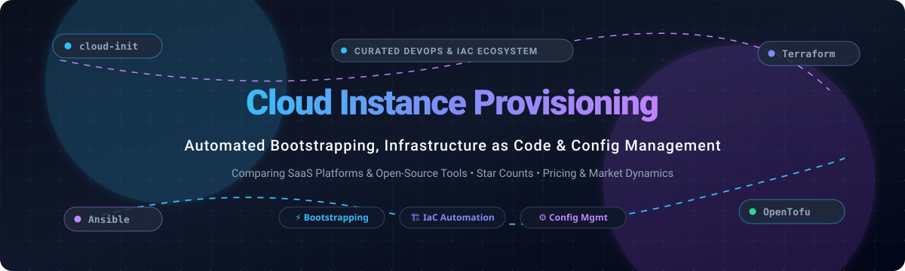

<div align="center">



# ⚡ Awesome Cloud Instance Provisioning ☁️

**A Curated Directory of SaaS Platforms & Open-Source Projects for Cloud Bootstrapping, Infrastructure as Code (IaC), and Automated Configuration Management**

<p align="center">
  <a href="https://github.com/ishandutta2007/Awesome-Awesome-Awesome"></a><a href="https://discord.gg/jc4xtF58Ve"></a>
  <a href="https://github.com/ishandutta2007/Awesome-Cloud-Instance-Provisioning/stargazers"></a>
  <a href="https://github.com/ishandutta2007/Awesome-Cloud-Instance-Provisioning/network/members"></a>
  <a href="https://github.com/ishandutta2007/Awesome-Cloud-Instance-Provisioning/blob/main/LICENSE"></a>
  <a href="https://github.com/ishandutta2007/Awesome-Cloud-Instance-Provisioning"></a>
  <a href="https://github.com/ishandutta2007"></a>
</p>

**Keywords:** `cloud-provisioning` • `infrastructure-as-code` • `iac` • `cloud-init` • `terraform` • `opentofu` • `ansible` • `packer` • `cloud-bootstrap` • `devops` • `platform-engineering` • `immutable-infrastructure` • `configuration-management`

---
</div>

> 🚀 **Welcome to the definitive cloud instance provisioning landscape!** This guide tracks the premier **SaaS platforms** and **open-source tooling** enabling DevOps, platform, and site reliability engineers (SREs) to automate the full lifecycle of cloud virtual machines, bare metal instances, and microVMs—from first-boot initialization and disk partitioning to full declarative infrastructure rollout and configuration management.

---

## 📑 Table of Contents

- [📊 Sector Overview & Market Dynamics](#-sector-overview--market-dynamics)
- [💼 SaaS & Hosted Platforms](#-saas--hosted-platforms)
- [🛠️ Open-Source GitHub Projects](#️-open-source-github-projects)
- [🏗️ Recommended Architecture Patterns](#️-recommended-architecture-patterns)
- [📈 Star History](#-star-history)
- [💖 Support & Sponsorship](#-support--sponsorship)
- [🤝 How to Contribute](#-how-to-contribute)
- [⚠️ Disclaimer](#️-disclaimer)

---

## 📊 Sector Overview & Market Dynamics

The global Infrastructure as Code (IaC) and cloud instance provisioning market is estimated at **$1.3B–$1.6B in 2025–2026** (scaling past **$6B+ by the early 2030s** at a ~20–25% CAGR), or upwards of **$39B+** when encompassing adjacent cloud automation and provisioning frameworks. The sector remains **moderately fragmented**—while hyperscaler-native tools dominate single-cloud footprints, multi-cloud enterprise mandates and ecosystem shifts (such as HashiCorp's BSL licensing change and the emergence of OpenTofu) have spurred healthy competition across independent orchestration, drift detection, and multi-IaC platforms rather than a single winner-take-all monopoly.

## 💼 SaaS & Hosted Platforms

| Platform | Company Valuation / Revenue (Size) | Starting Price (Paid) | Free Tier / Trial Limits | Description |
| :--- | :--- | :--- | :--- | :--- |
| **[Azure Bicep](https://learn.microsoft.com/en-us/azure/azure-resource-manager/bicep/)** (Microsoft) | **~$3.8T–$4.0T Market Cap** ($318.3B TTM Revenue) | **$0** (Free core tooling; underlying Azure compute/storage billed at standard pay-as-you-go rates) | **Forever Free** (100% free & open-source CLI, compiler, and language with no usage caps; underlying resources eligible for Azure Free Account: $200 credit for 30 days + 55+ always-free services) | Azure-native IaC language offering clean syntax, modular templates, and first-class integration with Azure Resource Manager (ARM). |
| **[AWS CloudFormation](https://aws.amazon.com/cloudformation/)** (Amazon AWS) | **~$2.7T–$2.8T Market Cap** ($638B–$742B TTM Revenue) | **$0** (Free for native `AWS::*` templates; custom extensions charge $0.0009 per handler operation beyond free tier) | **Forever Free** for all native `AWS::*` resource provisioning; Registry extensions include **1,000 handler operations/month** free per account; underlying AWS resources apply to standard AWS 12-month / always-free tier limits | AWS-native declarative IaC service featuring stacks, Change Sets, StackSets for multi-region/multi-account rollout, and IaC Generator. |
| **[Terraform Cloud (HCP Terraform)](https://www.hashicorp.com/products/terraform)** (HashiCorp / IBM) | **$6.4B Valuation** (Acquired by IBM; $583M annual revenue) | **$0.10 / resource / month** (Essentials tier; Standard starts at $0.47 / resource / month) | **Forever Free up to 500 managed resources**, unlimited users, 1 concurrent run, private module registry, and VCS-driven workflows | Managed IaC platform offering remote execution, private module registry, drift detection, and OPA/Sentinel policy as code. |
| **[Pulumi Cloud](https://www.pulumi.com/)** (Pulumi) | **~$100M–$400M Valuation** ($99M funding; ~$17M–$20M ARR) | **$40 / month** (Essentials tier with 40 credits; Pro starts at $400 / month with 400 credits) | **Forever Free for 1 user** with **unlimited resources**, unlimited projects/stacks, and 500 Deployments minutes/month | General-purpose programming language IaC (TypeScript, Python, Go) with managed state, secrets management (ESC), and CI/CD automation. |
| **[Spacelift](https://spacelift.io/)** (Spacelift) | **~$73.6M Total Funding** (~$15M–$20M ARR) | **$20,000 / year** (~$1,667 / month for Starter+ tier with 1 private worker and unlimited users) | **Forever Free for up to 2 users**, 1 concurrent run (public worker), unlimited stacks, and full IaC support (Terraform, OpenTofu, Pulumi, CloudFormation, Ansible); also offers a **14-day free trial** of paid tiers (no credit card required) | Sophisticated multi-IaC orchestration platform featuring OPA policy-as-code, stack dependencies, drift detection, and AI assistant. |
| **[env0](https://www.envzero.com/)** (env0) | **~$42M Total Funding** (~$6M–$9M ARR) | **~$1,500 / month** ($18,000 / year base for Cloud Navigator on AWS Marketplace; custom quotes per active env / apply) | **Forever Free up to 250 runs/month**, up to **30 active environments**, unlimited users, 1 concurrent deployment, and 1 self-hosted agent | Collaborative IaC automation and management platform supporting Terraform, Terragrunt, OpenTofu, and Pulumi with built-in cloud cost tracking. |

---

## 🛠️ Open-Source GitHub Projects

Curated list of leading open-source repositories for cloud instance bootstrapping, infrastructure automation, hypervisors, and configuration management. Sorted in **descending order by GitHub Stars_Count**.

1. **[Ansible](https://github.com/ansible/ansible)** [](https://github.com/ansible/ansible/stargazers)  
   **The most widely adopted open-source configuration management and automation platform** (GPL-3.0). Features an agentless architecture over SSH and WinRM. Ideal for post-boot software deployment, orchestration, role-based workflows, and application lifecycle automation.

2. **[LocalStack](https://github.com/localstack/localstack)** [](https://github.com/localstack/localstack/stargazers)  
   **A fully functional local cloud stack for testing cloud infrastructure and instance provisioning** (Apache-2.0 / Commercial). Enables developers to mock and provision AWS cloud instances, IAM, S3, and CloudFormation locally without incurring cloud costs.

3. **[Terraform](https://github.com/hashicorp/terraform)** [](https://github.com/hashicorp/terraform/stargazers)  
   **Industry-standard declarative Infrastructure as Code engine** (BSL-1.1). Manages cloud instances, networks, and services across 3,000+ providers using HashiCorp Configuration Language (HCL).

4. **[Firecracker](https://github.com/firecracker-microvm/firecracker)** [](https://github.com/firecracker-microvm/firecracker/stargazers)  
   **Secure and fast microVM virtualization engine for cloud-native serverless and instance provisioning** (Apache-2.0). Developed by AWS to power AWS Lambda and Fargate, launching minimal Linux kernels in under 5 milliseconds.

5. **[OpenTofu](https://github.com/opentofu/opentofu)** [](https://github.com/opentofu/opentofu/stargazers)  
   **Truly open-source Terraform fork hosted under the Linux Foundation** (MPL-2.0). Provides a community-governed, drop-in replacement for Terraform with end-to-end state encryption, client-side enhancements, and provider ecosystem parity.

6. **[Vagrant](https://github.com/hashicorp/vagrant)** [](https://github.com/hashicorp/vagrant/stargazers)  
   **Development environment virtualization and local instance automation tool** (BSL-1.1). Automates the creation and configuration of reproducible virtual machine environments across VirtualBox, VMware, AWS, and Hyper-V.

7. **[Pulumi](https://github.com/pulumi/pulumi)** [](https://github.com/pulumi/pulumi/stargazers)  
   **Cloud-native Infrastructure as Code SDK using general-purpose programming languages** (Apache-2.0). Write TypeScript, Python, Go, C#, or Java to declare cloud VMs, networks, and managed services with strong typing, IDE autocompletion, and native testing frameworks.

8. **[kOps (Kubernetes Operations)](https://github.com/kubernetes/kops)** [](https://github.com/kubernetes/kops/stargazers)  
   **Production-grade Kubernetes cloud instance provisioning and cluster lifecycle management** (Apache-2.0). Automatically provisions AWS, GCE, and OpenStack compute instances, load balancers, and systemd bootstrapping manifests.

9. **[Packer](https://github.com/hashicorp/packer)** [](https://github.com/hashicorp/packer/stargazers)  
   **Automated machine image builder for multi-platform virtual machines** (BSL-1.1). Compiles identical golden AMIs, Azure VHDs, GCP images, and VMware templates from a single declarative template for fast, immutable instance booting.

10. **[SaltStack (Salt)](https://github.com/saltstack/salt)** [](https://github.com/saltstack/salt/stargazers)  
    **High-speed, event-driven remote execution and configuration management engine** (Apache-2.0). Uses ZeroMQ or SSH for sub-second orchestration and includes Salt-Cloud for provisioning instances via Apache Libcloud across 20+ public clouds.

11. **[Infracost](https://github.com/infracost/infracost)** [](https://github.com/infracost/infracost/stargazers)  
    **Cloud cost estimates for Terraform and OpenTofu in pull requests** (Apache-2.0). Scans IaC templates to provide proactive instance pricing forecasts and prevent costly VM sizing errors before merging.

12. **[Crossplane](https://github.com/crossplane/crossplane)** [](https://github.com/crossplane/crossplane/stargazers)  
    **Kubernetes-native cloud control plane framework** (Apache-2.0). Transforms Kubernetes clusters into universal cloud control planes, managing VMs, instances, and DBs across AWS, GCP, and Azure using Custom Resource Definitions (CRDs).

13. **[Terragrunt](https://github.com/gruntwork-io/terragrunt)** [](https://github.com/gruntwork-io/terragrunt/stargazers)  
    **Flexible orchestration wrapper for Terraform and OpenTofu** (MIT). Enforces DRY infrastructure configurations, manages remote state backends across environments, and orchestrates multi-account VM deployments.

14. **[Atlantis](https://github.com/runatlantis/atlantis)** [](https://github.com/runatlantis/atlantis/stargazers)  
    **GitOps workflow pull-request automation for Terraform & OpenTofu** (Apache-2.0). Executes `plan` and `apply` commands directly via PR comments, ensuring infrastructure state consistency and peer code review for instance provisioning.

15. **[Multipass](https://github.com/canonical/multipass)** [](https://github.com/canonical/multipass/stargazers)  
    **Fast orchestrator for local cloud-init-enabled Ubuntu VM instances** (GPL-3.0). Lets developers simulate cloud instances locally with a single CLI command, supporting cloud-init metadata for rapid iteration.

16. **[Chef Infra](https://github.com/chef/chef)** [](https://github.com/chef/chef/stargazers)  
    **Declarative configuration management engine** (Apache-2.0). Enforces desired-state system configuration across thousands of cloud nodes using pure Ruby DSL recipes.

17. **[Puppet](https://github.com/puppetlabs/puppet)** [](https://github.com/puppetlabs/puppet/stargazers)  
    **Enterprise-grade declarative configuration management** (Apache-2.0). Provides automated drift correction, centralized reporting, and declarative infrastructure manifests across Windows and Linux cloud fleets.

18. **[Cloud Hypervisor](https://github.com/cloud-hypervisor/cloud-hypervisor)** [](https://github.com/cloud-hypervisor/cloud-hypervisor/stargazers)  
    **Modern, Rust-based Virtual Machine Monitor (VMM) for cloud workloads** (Apache-2.0 / BSD-3-Clause). Focuses exclusively on running modern cloud workloads with low latency, minimal memory footprint, and direct cloud instance isolation.

19. **[cloud-init](https://github.com/canonical/cloud-init)** [](https://github.com/canonical/cloud-init/stargazers)  
    **The industry-standard cross-platform cloud instance initialization package** (GPL-3.0 / Apache-2.0). Executes during early VM boot to read provider user-data, set hostnames, write SSH keys, partition storage, and trigger bootstrapping scripts across AWS, Azure, GCP, and OpenStack.

20. **[Terraform AWS VPC Module](https://github.com/terraform-aws-modules/terraform-aws-vpc)** [](https://github.com/terraform-aws-modules/terraform-aws-vpc/stargazers)  
    **The canonical Terraform module for AWS instance network provisioning** (Apache-2.0). Provisions complete VPCs, public/private subnets, NAT gateways, and routing tables required for secure cloud instance deployments.

21. **[OpenStack Nova](https://github.com/openstack/nova)** [](https://github.com/openstack/nova/stargazers)  
    **Cloud computing fabric controller for instance lifecycle management** (Apache-2.0). The compute engine powering private and public OpenStack clouds, handling scheduling, virtualization drivers (KVM/QEMU), and instance networking.

22. **[Chef InSpec](https://github.com/inspec/inspec)** [](https://github.com/inspec/inspec/stargazers)  
    **Compliance and security testing framework for cloud infrastructure** (Apache-2.0). Automates security audits and continuous compliance validation across provisioned cloud instances.

23. **[Ignition](https://github.com/coreos/ignition)** [](https://github.com/coreos/ignition/stargazers)  
    **Low-level first-boot provisioning utility for container Linux systems** (Apache-2.0). Runs during the initramfs stage to partition disks, format filesystems, create users, and write systemd units for Flatcar, RHCOS, and FCOS.

24. **[Puppet Bolt](https://github.com/puppetlabs/bolt)** [](https://github.com/puppetlabs/bolt/stargazers)  
    **Agentless multi-platform orchestration tool** (Apache-2.0). Connects directly via SSH and WinRM to execute ad-hoc commands, scripts, and tasks across heterogeneous cloud instance fleets.

25. **[Kubernetes Image Builder](https://github.com/kubernetes-sigs/image-builder)** [](https://github.com/kubernetes-sigs/image-builder/stargazers)  
    **Automated VM image builder for Cluster API providers** (Apache-2.0). Leverages Packer and Ansible to build standardized node images across AWS AMI, Azure VHD, GCP, and vSphere.

26. **[coreos-installer](https://github.com/coreos/coreos-installer)** [](https://github.com/coreos/coreos-installer/stargazers)  
    **Installer utility for Fedora CoreOS and RHEL CoreOS** (Apache-2.0). Installs container operating systems directly to bare metal or cloud block devices while embedding Ignition configurations.

---

## 🏗️ Recommended Architecture Patterns

For production-grade, highly reliable, and reproducible cloud instance provisioning:

```
[ Packer ] ──> Builds Immutable Golden Images (AMIs, VHDs)
     │
     ▼
[ OpenTofu / Terraform / Pulumi ] ──> Provisions Cloud VMs, Networks, Storage & Security Groups
     │
     ▼
[ cloud-init / Ignition ] ──> Performs First-Boot Initialization (Hostnames, SSH Keys, Disks)
     │
     ▼
[ Ansible / SaltStack ] ──> Orchestrates Application Deployment & Continuous Configuration
```

- **Provisioning vs. Configuration Management**: Use declarative IaC tools (OpenTofu, Terraform, Pulumi, CloudFormation) to allocate cloud fabric primitives (VPCs, EC2/Compute instances, firewall rules). Use configuration tools (Ansible, SaltStack) to manage in-guest runtimes and services.
- **The cloud-init + Ansible Synergy**: Rely on cloud-init strictly for the minimal first-boot handoff (users, keys, base dependencies) and trigger Ansible playbooks for higher-level application deployment.
- **Immutable Infrastructure**: Bake standard dependencies into base images with **Packer** to reduce boot times from minutes to seconds and prevent configuration drift.

---

## 📈 Star History

[](https://star-history.dera.page/#ishandutta2007/Awesome-Cloud-Instance-Provisioning&type=date&legend=top-left)

---

## 💖 Support & Sponsorship

If you find this curated landscape useful for your DevOps workflows, platform engineering initiatives, or cloud infrastructure architectures:

- ⭐ **Star this repository** to support discoverability on GitHub!
- 🍴 **Fork the repository** to contribute your favorite open-source tools or platform updates.
- 📢 **Share with your team** or community across Discord, Reddit, and LinkedIn.
- ☕ **Buy a coffee & sponsor ongoing maintenance:**  
  [](https://github.com/sponsors/ishandutta2007)

Your support directly funds research, regular verification of pricing/limits, and updates across the cloud-native ecosystem. Thank you! 🙏

---

## 🤝 How to Contribute

Contributions are warmly welcomed! To add or update an entry:

1. 🍴 **Fork this repository**.
2. 📝 **Edit `README.md`** following the existing layout and criteria:
   - For SaaS: Name, vendor, starting price, free tier limit, company valuation/revenue, and description.
   - For Open-Source: Name, link, stargazers badge (`style=social&color=white`), license, and practical use case.
3. 🚀 **Submit a Pull Request** with a clear explanation of why the tool belongs in the list.

---

## ⚠️ Disclaimer

- This is an **independent, community-curated list** — not an official endorsement of any commercial platform or open-source tool.
- Cloud instance provisioning tools manage sensitive infrastructure credentials (cloud IAM keys, SSH private keys). Always adhere to security best practices, least-privilege IAM policies, and encrypted state storage.
- Pricing, free tier allowances, and open-source star metrics are verified periodically and subject to change by respective upstream maintainers.

---

<div align="center">
  <sub>Built with ❤️ for platform engineers, SREs, and DevOps practitioners worldwide.</sub>
</div>

